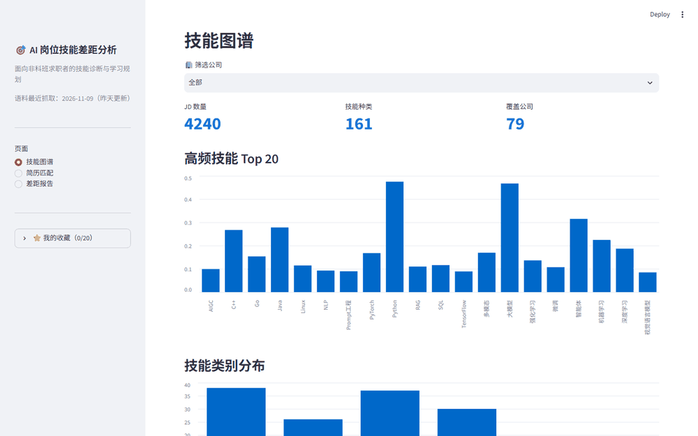

# AI Skill Gap Analyzer (ai-skill-gap)

English · [中文](README.md)

[](https://github.com/niko1major666/ai-skill-gap/actions)
[](https://github.com/niko1major666/ai-skill-gap/releases)
[](LICENSE)
[](https://www.python.org/)
[](https://streamlit.io/)

> **Upload a resume, and get told what a target AI job actually requires — and what to learn first.**
>
> **4,240** real AI job postings · **79** companies · **16** recruiting sources · **161** skills ·
> **106** learning resources. All collected from public job boards. No sign-up, no login,
> and the data-egress boundary is disclosed before any upload.

[**🚀 Live demo**](https://hdwqwu3howppf2z2xv9i2q.streamlit.app/) ·
[**📈 Metrics**](docs/metrics.md) ·
[**🔒 Privacy**](docs/privacy.md) ·
[**📦 Releases**](https://github.com/niko1major666/ai-skill-gap/releases)



## What it does (30 seconds)

| Input | Processing | Output |
|---|---|---|
| Your resume (PDF / Word / pasted text) | Structured parsing → skill entity extraction → semantic matching against job-post skills | Match score, must/nice gaps, P0/P1/P2 priorities, learning resources, exportable report |

**Three questions it answers:**

1. What are the **hard requirements** of this job? (must/nice is decided from the job text with a
   three-level rule, not guessed)
2. **Which skills am I missing**, and which of them are only nice-to-have?
3. **What should I learn first**, and roughly how long will it take?

## Three steps (hosted demo, nothing to install)

1. **Resume match** — paste resume text or upload a PDF/Word file; skills and experience are parsed automatically
2. **Pick a job** — search the 4,240 postings by company or keyword and select your target
3. **Read the gap report** — match score, missing-skill list, learning path; export to Markdown / Word, or bookmark the job

> The Streamlit Cloud instance sleeps when idle: the first visit may take 1–3 minutes to wake up.
> You can also run everything locally with the commands below.

## Why this exists

The hardest part of switching into AI is usually not effort — it is **not knowing what to learn**.
Job posts are vague ("familiarity with distributed training is a plus" — hard requirement or not?),
and learning material is scattered, so it is easy to spend months on the wrong things.

This project turns "what the job market actually asks for" into data: 4,240 postings from 16 public
recruiting channels, 161 granular skills with must/nice separation, compared against your resume to
produce an actionable gap list.

> Background: built by an undergraduate from a non-CS major switching into AI roles.
> No specific academic background is assumed; the tool works for any major.

## Core capabilities

| # | Capability | One-line summary |
|---|---|---|
| 1 | Skill extraction | 161 granular skills extracted from job text; rule baseline **F1 0.96** |
| 2 | must / nice classification | Three-level rule over the original posting text, so bonuses are not treated as hard gates |
| 3 | Resume matching | Resume text → skills → semantic matching with per-job scoring |
| 4 | Gap report | Missing skills, priority, learning resources, optional LLM commentary; Markdown / Word export |
| 5 | Multi-job view | Job comparison, reverse job recommendation, skill profile, company × skill matrix |
| 6 | Job-search loop | Bookmark shortlist (persisted in the URL), work/internship vs project classification, ATS advice |
| 7 | Privacy boundary | Explicit consent before upload, LLM enhancement off by default, PII masking before any external call |

## Tech stack

| Layer | Choice | Notes |
|---|---|---|
| Language | Python **3.12** | ML ecosystem on Windows |
| Extraction A | SiameseUIE (ModelScope) | Zero-shot baseline; measured F1 = 0 on abstract skill types |
| Extraction B | BERT-NER (transformers) | Fine-tuned on 30 manual + 400 weak-labeled spans |
| Extraction C | Dictionary rule baseline | Most stable for in-vocabulary skills (F1 0.96) |
| Matching A | TF-IDF (char n-gram) + cosine | Retrieval baseline |
| Matching B | BGE-base-zh-v1.5 (768-d) | Semantic matching, 2.25× Recall@5 on colloquial resume sentences |
| Frontend | Streamlit | Three pages + chart visualisation |
| Deployment | Local / Docker / Streamlit Community Cloud | Free tier with keep-alive workflow |

## Quick start

```powershell
# 1) Create a Python 3.12 venv, install deps, run the environment check
powershell -ExecutionPolicy Bypass -File scripts/setup_env.ps1

# 2) Build the structured dataset (job-title filtering applied)
.\.venv\Scripts\python.exe -m src.data.build_dataset --stats

# 3) Fast test suite (same as the CI PR job, 55% coverage gate)
.\.venv\Scripts\python.exe -m pytest -m "not slow" --cov=src --cov-report=term-missing --cov-fail-under=55

# 4) Full suite, including slow corpus-wide cases (~40s)
.\.venv\Scripts\python.exe -m pytest

# 5) Skill extraction demo (dictionary baseline + zero-shot SiameseUIE)
.\.venv\Scripts\python.exe -m src.extractor.siamese_uie --demo

# 6) Gap diagnosis demo (match score + missing skills + learning resources)
.\.venv\Scripts\python.exe -m src.matcher.gap_analyzer

# 7) Web UI (skill graph / resume match / gap report)
.\.venv\Scripts\python.exe -m streamlit run src/app/app.py

# 8) Regenerate metrics + validate the knowledge base (CI parity)
.\.venv\Scripts\python.exe scripts\eval_all.py
.\.venv\Scripts\python.exe scripts\validate_kb.py
```

> **383 tests** (381 fast + 2 slow). On Linux/macOS use `.venv/bin/python` instead of
> `.venv\Scripts\python.exe`.

### Docker

```bash
docker compose up --build
```

## Metrics

Every number below is produced by `python scripts/eval_all.py` and re-verified in CI
(see [docs/metrics.md](docs/metrics.md)). No hand-edited results.

### Skill extraction (span-level, dictionary rule baseline)

| Dataset | Samples | Precision | Recall | F1 (exact) | F1 (overlap) |
|---|---|---|---|---|---|
| gold test | 10 | 0.9167 | 1.0000 | **0.9565** | 0.9565 |
| gold train | 30 | 0.8913 | 0.9111 | 0.9011 | 0.9231 |
| gold all | 40 | 0.8966 | 0.9286 | **0.9123** | 0.9298 |

### Semantic matching (colloquial resume sentences → skill, 50 samples)

| Method | Recall@5 | MRR | Hit@1 |
|---|---|---|---|
| TF-IDF (char n-gram) | 0.24 | 0.146 | 0.10 |
| BGE-base-zh-v1.5 | **0.54** | **0.360** | **0.26** |

> Short skill names are easy for both methods (Recall@5 ≈ 0.975), but on real resume sentences that
> never mention the skill name, TF-IDF collapses to 0.22–0.24 while BGE holds 0.54 (2.25×) — which is
> why the "free-text resume → skills" path prefers BGE. Reproduce with
> `python scripts/eval_resume_match.py`.

### Single-request latency (CPU)

| Stage | Method | mean | p50 | p95 |
|---|---|---|---|---|
| Extraction | Rule baseline | 0.75 ms | 0.72 ms | 0.90 ms |
| Extraction | BERT-NER | 35.65 ms | 34.34 ms | 40.13 ms |
| Matching | TF-IDF | 0.75 ms | 0.69 ms | 1.19 ms |
| Matching | BGE | 17.81 ms | 17.21 ms | 21.00 ms |

### Corpus snapshot

- **4,240** job postings / **79** companies / **16** recruiting sources
- Zero-skill postings: **339 (8.0%)**, backfilled from similar postings at the same company
- Skill vocabulary coverage: **161/161 (100%)**
- Learning-resource coverage: **106/161** skills (65.8%), 118 resources

## How it works

```text
collection          extraction                matching              diagnosis          UI
raw CSV      ──▶  rules / UIE / NER   ──▶  TF-IDF / BGE   ──▶  score + priority ──▶  Streamlit
   │                   │                        │                    │                  │
jobs.jsonl        skills_long            skill-id match         GapReport         3 pages
```

Pipeline: `build_dataset` → `extractor` (rule / bert_ner / siamese_uie) → `matcher` (tfidf / bge)
→ `gap_analyzer` → `app`.

## Data sources

16 public recruiting channels, collected with plain HTTP requests and Playwright only where the
site requires rendering.

| Source type | Examples | Notes |
|---|---|---|
| Company career sites | Huawei (social + campus), Xiaomi (social + campus), Meituan (social + campus), ByteDance, Tencent, Bilibili, Didi, Kuaishou, Xiaohongshu | Public JSON endpoints; campus and social postings are kept as separate sources |
| AI-native companies | DeepSeek, Kimi (Moonshot), MiniMax | Small corpora, but highly relevant roles |
| Public dataset | English tech postings | 400 postings / 67 companies; the source has no publish timestamp |

Source-level health — volume, publish-time coverage, zero-skill ratio, stale ratio, disappearing
postings — is regenerated into [docs/source_health.md](docs/source_health.md), and CI fails if the
committed report is stale.

## Privacy and upload limits

- Consent is required before upload; the page states exactly what leaves your machine
- The LLM enhancement (DeepSeek) is **opt-in and off by default** — without it, everything runs locally
- Before any external call, emails, phone numbers, ID numbers, bank cards, WeChat/QQ IDs and detailed
  addresses are masked, and the text is truncated to 6,000 characters
- Upload limits: 5 MB per file, 30 PDF pages, 50,000 characters, 10 AI parses per session
- Parsed resumes live in `st.session_state` only — never in the cross-session cache

Full details: [docs/privacy.md](docs/privacy.md).

## Honest findings (negative results included)

1. **SiameseUIE zero-shot scores F1 = 0** on abstract skill categories, so the project keeps a dual
   path (dictionary baseline + fine-tuned BERT-NER) instead of relying on it.
2. **Weak labelling cannot replace manual annotation** for span boundaries: 400 auto-labelled
   postings lifted overlap F1 to 0.909, but exact F1 stayed at 0.545 — below the 30-manual-span
   model (0.636).
3. **A corpus review was unavoidable**: 1,607 postings that looked like AI jobs were actually
   non-technical or non-AI roles. Removing them took the zero-skill ratio from 22.7% to 8.0%
   without touching the extraction model.
4. **A high zero-skill ratio was mostly a classification problem**, not an extractor bug: after
   splitting technical vs non-technical postings, Kuaishou dropped from 32.5% to 4.6%.

## Limitations

- The corpus is **Chinese-market only** (aside from one English dataset); skill demand differs by region
- The dictionary approach cannot discover skills outside the 161-item vocabulary
- BGE is not part of automated CI metrics because the weights are large; its figures come from
  `scripts/eval_resume_match.py`
- 31 of 79 companies have ≤ 2 postings, so those rows in the company × skill matrix are noisy
- Publish-time coverage is 78.4%; beyond that, freshness relies on crawl timestamps

## Project structure

```text
ai-skill-gap/
├── configs/           dataset / extraction / matching YAML
├── data/
│   ├── raw/           raw postings per source (seed sample committed)
│   ├── processed/     jobs.jsonl + freshness state (tracked)
│   ├── gold/          manually annotated gold sets
│   └── kb/            skill taxonomy (161) + learning resources (106)
├── src/
│   ├── data/          schema, normalise, freshness, source health, privacy, build
│   ├── extractor/     dictionary baseline / BERT-NER / SiameseUIE
│   ├── matcher/       TF-IDF, BGE, gap analysis, learning path, comparison, recommender
│   ├── crawler/       16 source adapters
│   └── app/           Streamlit UI (3 pages)
├── scripts/           evaluation, merge, source health, preflight checks, KB validation
├── tests/             383 pytest cases
└── docs/              metrics, source health, privacy, release notes
```

## Contributing

Issues and pull requests are welcome — the most useful contributions right now are:

- additional public recruiting sources (with a link to the public endpoint)
- corrections to the skill taxonomy or learning resources
- reports of skills that the dictionary extractor misses

Please run `pytest -m "not slow"` and `python scripts/validate_kb.py` before opening a PR.

## License

MIT — see [LICENSE](LICENSE).
