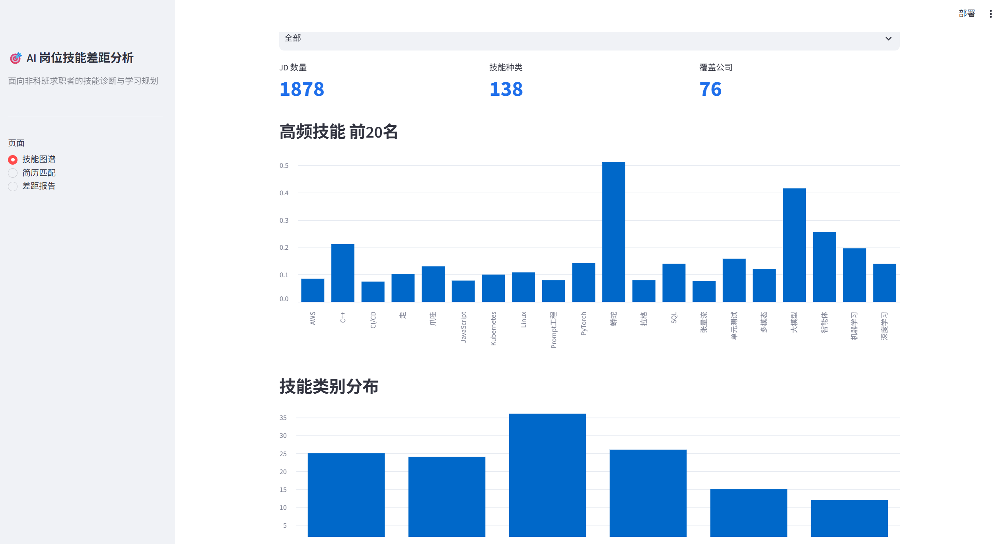
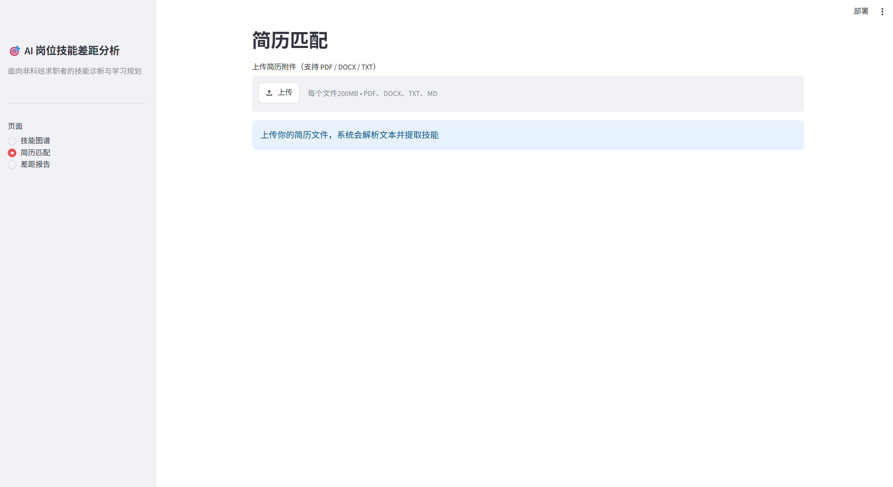
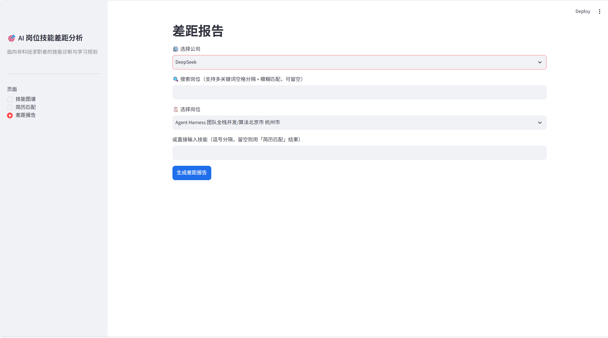

# AI 岗位技能差距分析系统（ai-skill-gap）

[](https://github.com/niko1major666/AI-/actions)
[](LICENSE)
[](https://www.python.org/)
[](https://streamlit.io/)

> 🚀 **在线体验（Streamlit Cloud）**：https://hdwqwu3howppf2z2xv9i2q.streamlit.app/

面向**非科班与转行求职者**的个人项目：分析目标 AI 岗位所需技能，与自身简历对比，
输出技能差距报告与学习优先级。体现 **NLP 信息抽取 + 语义匹配 + 工程落地** 能力。

> 作者背景：非科班大四学生，转投 AI+ 岗位。系统不预设用户的具体专业背景，任何专业均可直接使用。

## 一、功能

1. 采集 AI 岗位 JD（Kaggle / 爬虫 / 本地 CSV，以华为等公司优先）
2. 从 JD 抽取细粒度技能实体（`分布式训练`、`向量数据库`、`Transformer` 等专有技能）
3. 用户输入简历文本/技能列表，与 JD 技能做语义匹配
4. 输出匹配度打分 + 逐项对比 + 差距报告（缺失技能/优先级/学习资源）
5. Streamlit 三页面：技能图谱 / 简历匹配 / 差距报告

## 二、技术选型

| 层 | 选型 | 说明 |
|---|---|---|
| 语言 | Python **3.12** | 本机已具备，ML 生态最稳 |
| 抽取 A | SiameseUIE（ModelScope） | 零样本，第 1 周快速跑通 |
| 抽取 B | BERT-NER（transformers） | 第 3 周提精度，产出 F1 对比 |
| 匹配 A | TF-IDF（char n-gram）+ 余弦 | 中文检索基线/对照组 |
| 匹配 B | BGE-base-zh-v1.5（768 维） | 语义匹配，第 4 周接入 |
| 前端 | Streamlit | 三页面 + 图谱可视化 |
| 部署 | 本地运行，可选 Docker | 第 5 周 |

## 三、关键依赖锁（★ 必读，防 modelscope 崩）

```text
torch>=2.5,<3
transformers>=4.57,<5          # ★ ModelScope 1.x 的 siamese_uie 是 transformers 4.x 时代代码，装 5.x 会崩
sentence-transformers>=5.1,<6  # ★ 6.x 强制 transformers>=5，与上一条冲突
tokenizers>=0.22,<=0.23.0
datasets>=4.0,<=4.8.4
modelscope[framework]>=1.40
```

> 完整清单见 `requirements.txt`。运行 `scripts/check_env.py` 可体检实际安装版本 vs 锁矩阵。

## 四、目录结构

```
ai-skill-gap/
├── configs/            dataset / extraction / matching 三份 YAML
├── data/
│   ├── raw/            原始 JD（seed 样例 sample_jobs.csv 已入库）
│   ├── processed/      清洗后结构化数据（jobs.jsonl / 统计）
│   ├── gold/           人工标注金标准（算 F1 / Recall@5）
│   └── kb/             skill_taxonomy(147技能·难度+重要度[需求频率驱动]) / learning_resources
├── src/
│   ├── data/           schema / normalize / load / build（★ 第一步已实现并测试）
│   ├── extractor/      SiameseUIE / BERT-NER / 规则基线
│   ├── matcher/        TF-IDF / BGE / gap 分析
│   ├── crawler/        11 源爬虫（腾讯/字节/小米社招/小米校招/DeepSeek/Kimi/MiniMax/快手/小红书/华为 + 英文科技岗位）
│   └── app/            Streamlit 三页面
├── scripts/            setup_env / check_env / merge_jobs / recrawl_all / recalc_importance
├── tests/              pytest（91 用例已通过）
├── docs/               images/（README 界面预览截图，3 张）
├── models/             模型与缓存（重资产，git 忽略）
├── requirements.txt
└── README.md
```

## 五、快速开始

```powershell
# 1) 建 Python 3.12 venv + 装依赖 + 体检（缓存全部落在项目内，不占系统盘）
powershell -ExecutionPolicy Bypass -File scripts/setup_env.ps1

# 2) 构建结构化数据集
.\.venv\Scripts\python.exe -m src.data.build_dataset --stats

# 3) 跑测试
.\.venv\Scripts\python.exe -m pytest tests -v

# 4) 技能抽取 demo（词表规则基线 + SiameseUIE 零样本）
.\.venv\Scripts\python.exe -m src.extractor.siamese_uie --demo

# 5) 差距诊断 demo（匹配度 + 缺失技能 + 学习资源）
.\.venv\Scripts\python.exe -m src.matcher.gap_analyzer

# 6) 前端（技能图谱 / 简历匹配 / 差距报告）
.\.venv\Scripts\python.exe -m streamlit run src/app/app.py
```

### 界面预览（三页面）

**技能图谱**：行业技能结构（JD / 技能 / 公司统计 + 高频技能 + 共现网络）



**简历匹配**：上传简历 → 结构化解析（正则 + DeepSeek LLM，含工作经历细粒度：职责/量化成果/技术栈）→ 技能提取 → ATS 建议



**差距报告**：选公司 → 搜岗位 → 选目标岗位 → 生成差距报告（缺失技能 + 优先补充建议）



### Docker 方式（可选）

模型权重通过 volume 复用宿主（不打进镜像，避免镜像过大）：

```powershell
docker compose up --build -d   # 构建并启动，访问 http://localhost:8501
```

### 云端部署（Streamlit Community Cloud，免费）

> 🌐 已部署上线：https://hdwqwu3howppf2z2xv9i2q.streamlit.app/

本项目已为云端部署优化：`requirements.txt` 只含运行所需轻量依赖（重模型在 `requirements-ml.txt`，云端不装），清洗后的数据 `data/processed/jobs.jsonl` 已纳入版本管理。

1. 把仓库推送到 GitHub（public）
2. 登录 https://share.streamlit.io → New app → 选择本仓库
3. Main file path 填 `src/app/app.py`
4. Settings → Secrets 填入（云端密钥，不经过 git）：
   ```toml
   DEEPSEEK_API_KEY = "你的DeepSeek密钥"
   ```
5. Deploy，即可获得公网访问链接

> 本地开发如需 BERT-NER/BGE 训练评测：`pip install -r requirements.txt -r requirements-ml.txt`

### 保持云端长期在线（Keep-Alive）

Streamlit Community Cloud 的应用在一段时间无人访问后会休眠（sleep），下次访问需等待冷启动。本仓库内置保活方案：

- **GitHub Actions 定时探测**：`.github/workflows/keep-streamlit-alive.yml`，每 6 小时运行一次。
  先用 HTTP 探测（主页 + `/~/+/_stcore/health`）判断是否在线，失败时自动启动无头浏览器真实访问（建立 websocket）完成唤醒。
- **本地手动保活**：

  ```powershell
  .\.venv\Scripts\python.exe scripts\keepalive_app.py            # 探测，必要时自动唤醒
  .\.venv\Scripts\python.exe scripts\keepalive_app.py --browser  # 强制浏览器真实访问
  ```

- **交互式维护 workflow**（Linux / macOS / Git Bash）：

  ```bash
  bash scripts/keepalive.sh
  ```

- 应用地址可用环境变量覆盖：`STREAMLIT_APP_URL=https://xxx.streamlit.app/`

> 注意：GitHub 仓库若连续 60 天无提交，定时任务会被自动停用，可在 Actions 页面用 `workflow_dispatch` 手动跑一次；也可叠加 UptimeRobot / cron-job.org 等外部监控作为双保险。

## 六、环境说明（本机实测）

- 项目盘 **D:**（141 GB 空闲）；`HF_HOME / MODELSCOPE_CACHE / UV_CACHE_DIR` 全部指向项目内 `models/`，删除项目即彻底释放
- 默认 PyPI torch 为 **CPU 版**；GPU（RTX 3050 4GB）在第 4 周 benchmark 时按需切 CUDA（见下）
- 国内镜像：`HF_ENDPOINT=https://hf-mirror.com`、pip 走清华源（均实测可达）

### GPU 加速（可选，第 4 周）

```powershell
.\.venv\Scripts\python.exe -m pip install torch --index-url https://download.pytorch.org/whl/cu124
```

## 七、路线图

| 周 | 交付 | 验收 |
|---|---|---|
| W0 | 环境+骨架+契约+数据模块 | ✅ 14 测试通过，CLI 出 jobs.jsonl |
| W1 | SiameseUIE 抽取 + 词表规则基线 | ✅ 29 测试通过，demo 端到端跑通 |
| W2 | TF-IDF 匹配 + 差距诊断 + Streamlit MVP | ✅ 36 测试通过，三页面 AppTest 通过 |
| W3 | BERT-NER 替换，F1 对比 | ✅ 微调 bert-base-chinese，F1 0.636(exact)/0.909(overlap) vs SiameseUIE 0.000 |
| W4 | BGE 匹配，Recall@5 对比 | ✅ BGE vs TF-IDF：Recall@5 均 0.975，MRR/Hit@1 BGE 更优 |
| W5-6 | 美化 + Docker + README 量化指标 | `docker build -t ai-skill-gap .` |

## 八、数据采集与爬虫

### 数据源总览（4586 条 / 78 家公司，清洗去重后；原始 5013 条）

| 数据源 | 平台 / 接口 | 技术方案 | 条数 | 部门/发布时间 |
|---|---|---|---|---|
| 腾讯 | careers.tencent.com 公开 JSON | requests + 限速 | 500 | ✅ BGName / LastUpdateTime |
| 字节跳动 | jobs.bytedance.com `_signature` 签名接口 | Playwright 拦截 + 滚动懒加载 | 261 | ✅ job_category / publish_time |
| 小米（社招） | hr.xiaomi.com 公开 GET | requests + 多关键词 | 600 | ✅ levelOneDeptName / publishTime |
| 小米（校招） | 飞书招聘 SaaS `_signature` + 虚拟列表 | Playwright 拦截 + 搜索框交互 | 110 | ✅ job_function / publish_time |
| DeepSeek | Moka 平台（详情接口加密 necromancer） | Playwright DOM 抓列表 | 33 | ❌ 仅列表 |
| Kimi（月之暗面） | Moka 平台（详情接口加密） | Playwright DOM 抓列表 | 30 | ❌ 仅列表 |
| MiniMax | 飞书招聘 SaaS `search/job/posts` | Playwright 拦截复用 | 60 | ✅ |
| 快手（社招） | zhaopin.kuaishou.cn 公开接口 | requests + sign 逆向（HMAC-SHA256） | 1179 | ❌ 无发布时间 |
| 快手（校招） | campus.kuaishou.cn 公开 POST | requests（无 sign） | 266 | ✅ departmentName / releaseTime |
| 小红书（社招） | job.xiaohongshu.com `pageQueryPosition` | requests POST（无需签名） | 836 | ✅ jobType / publishTime |
| 小红书（校招） | 同上，`recruitType=campus` | requests POST 翻页 | 448 | ✅ jobType / publishTime |
| 华为 | career.huawei.com 公开 GET + 51job 尝试 | requests + Playwright | 2 | ❌ 门户已枯竭，第三方 AI 岗极少 |
| 英文科技岗位 | HuggingFace `tech-job-postings` 数据集 | `download_tech_jobs.py` | 600 | ❌ |

### 关键技术难点

1. **`_signature` 签名**（字节 / 小米校招 / MiniMax）：岗位接口 POST 带前端 JS 生成的 `_signature` 签名，直接构造请求成本高，改为 Playwright 让页面自行发请求并拦截响应（`page.on("response")`）拿到真实 JSON。
2. **sign 签名逆向**（快手社招）：`zhaopin.kuaishou.cn` 接口要求 `sign` + `signtimestamp` 请求头，`sign = HMAC-SHA256(secret, timestamp + canonicalize(query) + secret)`（secret 从前端 JS 逆向），规范化排序 query 参数后计算；校招接口无 sign，直接 POST。
3. **虚拟列表懒加载**（字节 / 小米校招）：岗位列表只渲染可视区，需滚动自定义滚动容器触发分页 XHR，多关键词遍历以突破单次结果上限。
4. **详情接口加密**（DeepSeek / Kimi · Moka）：详情接口响应被 `necromancer` 加密，未逆向，只抓已渲染列表（标题+类别+地点，含 AI 技能词）。
5. **门户岗位稀缺**（华为）：官网门户社招 2 条 / 校招 0 条已枯竭；51job 等第三方平台投放的多为非 AI 岗，BOSS直聘/猎聘需登录——华为 AI 核心岗位走官网/内推/校招渠道，公开数据源受限。
6. **SPA 签名头排查**（小红书）：站点会加载 `as.xiaohongshu.com` 安全 SDK 并给业务请求注入 `x-s` 签名头，但 `websiterecruit/position/pageQueryPosition` 实测**未强制校验**——直接 requests POST（`pageSize=100`）即可翻页拿到含 `duty` + `qualification` 的完整 JD，无需 Playwright。数据比列表页 DOM 更完整（社招 864 / 校招 508）。

### 复现采集

```powershell
# 一键顺序重爬 8 个数据源（约 20+ 分钟，含 Playwright 交互）
.\.venv\Scripts\python.exe scripts/recrawl_all.py

# 快手（社招 sign 逆向 + 校招 POST，约 1445 条）
.\.venv\Scripts\python.exe -m src.crawler.kuaishou

# 小红书（社招 864 + 校招 508，requests 直连，约 1 分钟）
.\.venv\Scripts\python.exe -m src.crawler.xiaohongshu

# 十一源合并 -> data/raw/all_jobs.csv
.\.venv\Scripts\python.exe scripts/merge_jobs.py

# 清洗 + 去重 + 技能抽取 -> data/processed/jobs.jsonl
.\.venv\Scripts\python.exe -m src.data.build_dataset --stats

# 语料变化后重算 147 技能重要度（JD 需求占比分档 → importance 1~5）
.\.venv\Scripts\python.exe scripts/recalc_importance.py
```

> 合规：仅抓取官网公开岗位，请求带限速；数据仅供个人学习研究。

## 九、量化指标（简历用）

- 采集 JD 数量 / 覆盖公司数（`build_dataset --stats`）：**4586 条 / 78 家**（原始 5013 条去重后；含小红书 1284[社招836+校招448]、快手 1445[社招1179+校招266]、腾讯500、字节261、小米710[社招600+校招110]、DeepSeek33、Kimi30、MiniMax60、华为2、英文科技岗位600）
- 技能重要度（`recalc_importance.py`，全语料需求占比分档 ≥10%→5 / ≥5%→4 / ≥2%→3 / ≥1%→2 / <1%→1）：Top 为大模型 36.2%、Python 36.0%、智能体 22.3%、C++ 18.3%、Java 16.4%、机器学习 16.3%、SQL 13.9%、多模态 13.0%
- 技能抽取 F1（SiameseUIE vs BERT-NER，在 `data/gold/jd_skills_gold.jsonl` 上算 span 级）
- 语义匹配 Recall@5（BGE vs TF-IDF，在 `data/gold/skill_pair_gold.jsonl` 上算）
- 单次推理延迟（`scripts/benchmark.py`，CPU/GPU 两口径）

### 已产出：技能抽取 F1 对比（测试集 10 条，span 级）

| 方法 | P | R | F1(exact) | F1(overlap) |
|---|---|---|---|---|
| 规则基线（词表字典） | 0.917 | 1.000 | 0.957 | 0.957 |
| SiameseUIE（零样本） | 0.000 | 0.000 | 0.000 | 0.000 |
| BERT-NER（30 人工 + 400 弱标注） | 0.545 | 0.545 | 0.545 | 0.909 |

> 结论：SiameseUIE 零样本对抽象技能类别召回为 0（已实测），微调 BERT-NER 显著提升（0→0.64/0.91）；
> 词表规则基线对「词表内技能」最稳（0.96），但无法发现词表外新技能——两者互补，正是保留双路抽取的原因。
>
> 弱标注实验（诚实）：用规则基线自动标注 400 条真实 JD 扩充训练集，整段 JD 训练导致 recall 崩溃
> （exact 0.125）；改为「围绕技能 span 裁剪短上下文」后 overlap 恢复到 0.909、exact 0.545 仍略低于
> 30 条人工标注（0.636）——弱标注伪标签的边界噪声无法替代人工标注，提升 BERT-NER 需人工标注更多样本。

### 已产出：语义匹配 Recall@5 对比（40 条口语表述→技能，语料 128 技能）

| 方法 | Recall@5 | MRR | Hit@1 |
|---|---|---|---|
| TF-IDF（char 2-4 gram） | 0.975 | 0.933 | 0.900 |
| BGE-base-zh-v1.5 | 0.975 | 0.944 | 0.925 |

> 结论：短技能名匹配任务上两者 Recall@5 相当（都接近满分），但 BGE 排序精度更高
> （MRR +0.011、Hit@1 +0.025）；BGE 的真正优势在长句/口语化表述的语义匹配（子句级匹配），
> 这也是差距报告中"简历自由文本 → 技能"场景应优先用 BGE 的原因。

### 已产出：语义匹配 Recall@5（口语化简历句子 → 技能，50 条不含技能词，语料 147 技能）

| 方法 | Recall@5 | MRR | Hit@1 |
|---|---|---|---|
| TF-IDF（char 2-4 gram） | 0.24 | 0.146 | 0.10 |
| BGE-base-zh-v1.5 | **0.54** | **0.360** | **0.26** |

> 结论：换成真实简历场景（口语化句子、不含技能词）后任务难度骤升，TF-IDF 字符匹配
> 几乎失效（0.975→0.24），BGE 凭语义理解仍有 0.54 Recall@5（2.25 倍于 TF-IDF），
> 且 BGE 额外命中 15 条语义样本、反向漏掉 0 条——实证了「简历自由文本→技能」应优先用 BGE。
> 复现：`python scripts/eval_resume_match.py`

### 已产出：单次推理延迟（CPU，单条 JD 文本 / 单条 query）

| 阶段 | 方法 | mean | p50 | p95 |
|---|---|---|---|---|
| 抽取 | 规则基线 | 0.75ms | 0.72ms | 0.90ms |
| 抽取 | BERT-NER | 35.65ms | 34.34ms | 40.13ms |
| 抽取 | SiameseUIE | 75.39ms | 74.37ms | 77.38ms |
| 匹配 | TF-IDF | 0.75ms | 0.69ms | 1.19ms |
| 匹配 | BGE | 17.81ms | 17.21ms | 21.00ms |

## 十、已核实结论（诚实标注）

1. Kaggle「AI Jobs Dataset 2026」**不存在**——已改用 HuggingFace `zalizedata/tech-job-postings-salary-dataset`（600 条真实科技岗位）
2. `Nucha_SkillNER_BERT` **不存在**——已按 fallback 用 `bert-base-chinese` 自标注微调（F1 0.636/0.909）
3. SiameseUIE 零样本对抽象技能类别 **F1=0**（已实测）——故保留「规则基线 + BERT-NER」双路抽取

## 十一、架构与数据流

```
数据采集         技能抽取            语义匹配          差距诊断         前端展示
raw CSV   ──▶  规则基线/UIE/NER  ──▶  TF-IDF/BGE  ──▶  打分+优先级  ──▶  Streamlit
 │                │                   │                │                 │
jobs.jsonl     skills_long        skill_id 匹配      GapReport        3 页面
```

关键链路：`build_dataset` → `extractor`(rule/bert_ner/siamese_uie) → `matcher`(tfidf/bge) → `gap_analyzer` → `app`

## 十二、排障记录（踩坑与解法）

1. **uv venv 无 pip** → ModelScope 加载模型报 `No module named pip`：补装 pip + 对齐模型 pin 的 `transformers==4.48.3`
2. **ModelScope 不转发 trust_remote_code** → 官方 SiameseUIE 模型被安全拦截：幂等 monkeypatch `SiameseUiePipeline.__init__`
3. **transformers 版本耦合** → 锁 `transformers<5`、`sentence-transformers<6`，防止 modelscope 崩
4. **SiameseUIE 输出为嵌套 list** `{'output': [[...]]}` → 递归展开解析
5. **Windows 无 symlink** → HF 缓存降级警告（无害），设 `HF_HUB_DISABLE_SYMLINKS_WARNING` 可静默
