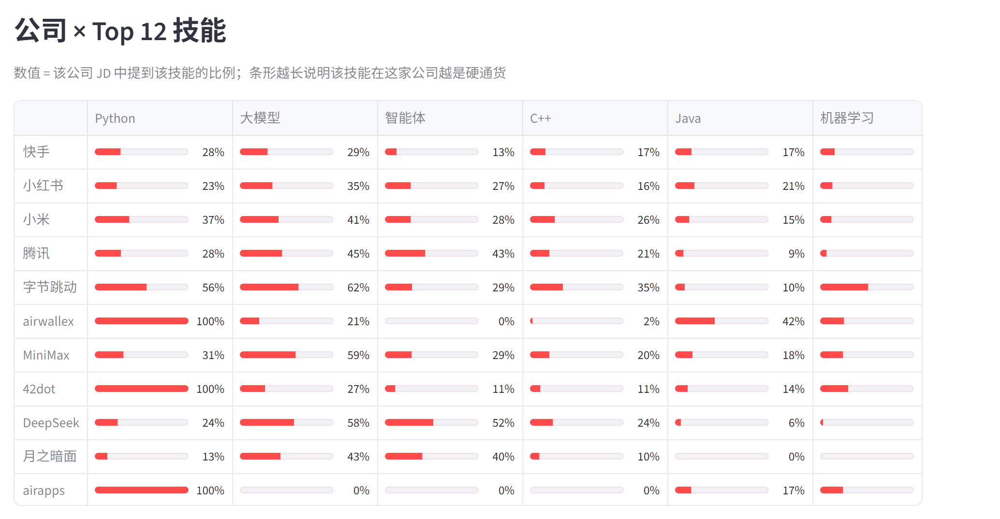
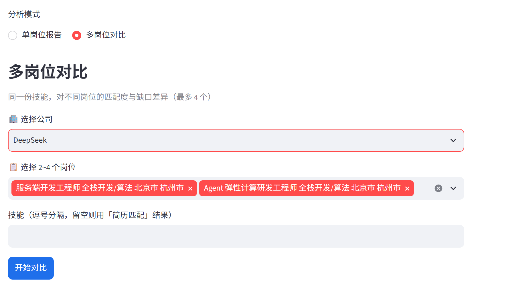

# AI 岗位技能差距分析系统（ai-skill-gap）

[](https://github.com/niko1major666/AI-/actions)
[](https://github.com/niko1major666/AI-/releases)
[](LICENSE)
[](https://www.python.org/)
[](https://streamlit.io/)

> 🚀 **在线体验（Streamlit Cloud）**：https://hdwqwu3howppf2z2xv9i2q.streamlit.app/

面向**非科班与转行求职者**的个人项目：分析目标 AI 岗位所需技能，与自身简历对比，
输出技能差距报告与学习优先级。体现 **NLP 信息抽取 + 语义匹配 + 工程落地** 能力。

> 作者背景：非科班大四学生，转投 AI+ 岗位。系统不预设用户的具体专业背景，任何专业均可直接使用。

## 一、功能

1. 采集 AI 岗位 JD（Kaggle / 爬虫 / 本地 CSV，以华为等公司优先）
2. 从 JD 抽取细粒度技能实体（`分布式训练`、`向量数据库`、`Transformer` 等专有技能）
3. 用户输入简历文本/技能列表，与 JD 技能做语义匹配（简历解析出的专业与技能自动带入差距报告）
4. 输出匹配度打分 + 逐项对比 + 差距报告（缺失技能/优先级/学习资源）；AI 解读会结合简历解析出的专业给出迁移建议（未识别到专业则不展示）
5. must/nice 判定读 JD 原文（句内触发词 → 章节标题 → 全行业占比兜底），再按「岗位内提及次数」加权，避免把加分项当硬门槛；零技能岗位用同公司相似岗位兜底并标注来源
6. Streamlit 三页面：技能图谱 / 简历匹配 / 差距报告
7. 知识库持续扩充：161 项技能（含 MCP、Function Calling、扩散模型、视觉语言模型、LangGraph、Dify、昇腾等高频缺失项）+ 106 项学习资源；高噪声写法（如裸「量化」= 可量化/量化指标）只在简历解析侧生效，不参与 JD 抽取
8. 学习与投递闭环：**规则版学习路径**（无 API key 也出三阶段计划，含先修顺序/学时/周数）、**简历补强建议**（针对 P0 缺口给出「改写要点」或「补小项目」，不编造经历）、**报告导出**（Markdown / Word）
9. 多岗位视角：**多岗位对比**（匹配度、共性缺口、各岗独有缺口）、**反向岗位推荐**（简历技能 → Top 10 岗位）、**技能画像**（按类别的需求加权覆盖率）、**公司 × Top 技能矩阵**（技能图谱页）
10. 求职闭环：简历经历区分 **工作/实习** 与 **项目**（LLM 判定 → 正则按章节/角色兜底，教育经历不计入），ATS 建议分别提示缺哪类经历；**岗位收藏夹**（差距报告/简历推荐一键收藏，按「公司 + 归一化标题」去重、上限 20，收藏写进链接 `?fav=` 刷新不丢，可导出 JSON），侧边栏跨页面查看与移除
11. 简历隐私与上传边界：上传前必须确认**隐私说明**，DeepSeek 增强**单独可选、默认关闭**；仅外发前 6,000 字且强制隐藏邮箱/手机号/证件号/银行卡/微信 QQ/详细住址；单文件 ≤5 MB、PDF ≤30 页、文本 ≤5 万字、每会话 ≤10 次 AI 简历解析。完整说明见 [`docs/privacy.md`](docs/privacy.md)

## 二、技术选型

| 层 | 选型 | 说明 |
|---|---|---|
| 语言 | Python **3.12** | 本机已具备，ML 生态最稳 |
| 抽取 A | SiameseUIE（ModelScope） | 零样本，第 1 周快速跑通 |
| 抽取 B | BERT-NER（transformers） | 第 3 周提精度，产出 F1 对比 |
| 匹配 A | TF-IDF（char n-gram）+ 余弦 | 中文检索基线/对照组 |
| 匹配 B | BGE-base-zh-v1.5（768 维） | 语义匹配，第 4 周接入 |
| 前端 | Streamlit | 三页面 + 图谱可视化 |
| 部署 | 本地运行，可选 Docker | 第 5 周 |

## 三、关键依赖锁（★ 必读，防 modelscope 崩）

```text
torch>=2.5,<3
transformers>=4.57,<5          # ★ ModelScope 1.x 的 siamese_uie 是 transformers 4.x 时代代码，装 5.x 会崩
sentence-transformers>=5.1,<6  # ★ 6.x 强制 transformers>=5，与上一条冲突
tokenizers>=0.22,<=0.23.0
datasets>=4.0,<=4.8.4
modelscope[framework]>=1.40
```

> 完整清单见 `requirements.txt`。运行 `scripts/check_env.py` 可体检实际安装版本 vs 锁矩阵。

## 四、目录结构

```
ai-skill-gap/
├── .streamlit/         config.toml（服务端上传上限 5 MB）+ secrets（不入库）
├── configs/            dataset / extraction / matching 三份 YAML
├── data/
│   ├── raw/            原始 JD（seed 样例 sample_jobs.csv 已入库）
│   ├── processed/      清洗后结构化数据（jobs.jsonl / 统计）
│   ├── gold/           人工标注金标准（算 F1 / Recall@5）
│   └── kb/             skill_taxonomy(161技能·难度+重要度[需求频率驱动]) / learning_resources(106 项)
├── src/
│   ├── data/           schema / normalize / freshness(★新鲜度) / source_health(来源健康) / privacy(★PII/上传边界) / job_filter(★标题过滤) / load / build_dataset / skill_stats / resume_advice
│   ├── extractor/      SiameseUIE / BERT-NER / 规则基线
│   ├── matcher/        TF-IDF / BGE / gap 分析 / jd_requirements(must 判定) / job_neighbors(零技能代理)
│   │                   / learning_path(规则学习路径) / job_compare(多岗对比) / job_recommender(反向推荐) / strength_profile(技能画像) / job_favorites(岗位收藏)
│   ├── crawler/        13 个爬虫模块 / 14 个数据源（腾讯/字节/小米社招/小米校招/DeepSeek/Kimi/MiniMax/快手/小红书/哔哩哔哩/滴滴/美团/华为 + 英文科技岗位）
│   └── app/            Streamlit 三页面 + report_export（报告导出）
├── scripts/            setup_env / check_env / merge_jobs / recrawl_all / recalc_importance / eval_all(评测) / source_health(来源健康) / validate_kb(KB 校验)
├── tests/              pytest（310 用例已通过，其中 2 个 slow 留给 nightly）
├── docs/               images/（README 界面预览截图 5 张，scripts/capture_screenshots.py 可重截）+ metrics.md（自动生成的回归基线）+ source_health.md（来源健康）+ privacy.md（简历隐私说明）
├── models/             模型与缓存（重资产，git 忽略）
├── requirements.txt
└── README.md
```

## 五、快速开始

```powershell
# 1) 建 Python 3.12 venv + 装依赖 + 体检（缓存全部落在项目内，不占系统盘）
powershell -ExecutionPolicy Bypass -File scripts/setup_env.ps1

# 2) 构建结构化数据集（含岗位标题过滤：剔除土木/施工等非 AI 岗位）
.\.venv\Scripts\python.exe -m src.data.build_dataset --stats

# 3) 跑测试（PR 同款：跳过 slow，带覆盖率门槛）
.\.venv\Scripts\python.exe -m pytest -m "not slow" --cov=src --cov-report=term-missing --cov-fail-under=55

# 3.1) 全量测试（含全语料遍历的 slow 用例，约 40s）
.\.venv\Scripts\python.exe -m pytest

# 4) 技能抽取 demo（词表规则基线 + SiameseUIE 零样本）
.\.venv\Scripts\python.exe -m src.extractor.siamese_uie --demo

# 5) 差距诊断 demo（匹配度 + 缺失技能 + 学习资源）
.\.venv\Scripts\python.exe -m src.matcher.gap_analyzer

# 6) 前端（技能图谱 / 简历匹配 / 差距报告）
.\.venv\Scripts\python.exe -m streamlit run src/app/app.py

# 7) 指标回归报告 + 知识库校验（CI 同款）
.\.venv\Scripts\python.exe scripts\eval_all.py       # 生成 docs/metrics.md
.\.venv\Scripts\python.exe scripts\validate_kb.py    # 词表/资源结构校验
```

### 界面预览（三页面）

**技能图谱**：行业技能结构（JD / 技能 / 公司统计 + 高频技能 + 共现网络）


**公司 × Top 12 技能**（技能图谱页）：把全行业需求最高的 12 项技能放进同一张表，对比各家公司的「技能偏好」

- 行 = 公司（按 JD 数降序，样本量大的在前）；列 = 全行业需求占比 Top 12（大模型 38.6%、Python 36.8%、智能体 26.4%、Java 20.4%、C++ 19.5% …），12 列可横向滚动（截图为前 6 列）
- 数值 = 该公司 JD 中提到该技能的比例。横向看同一技能的公司差异（大模型：字节 62% / MiniMax 59% / DeepSeek 58%，快手 29%），纵向看一家公司的长短板（腾讯「智能体」43%，明显高于行业的 26.4%）
- 读图提示：81 家里有 31 家 JD ≤ 2 条，这类行容易出现 0% / 100% 的极端值，看趋势请优先看 JD 数多的行；顶部「筛选公司」选「全部」是行业画像，选中某一家则只统计该公司的 JD



**简历匹配**：确认隐私说明 → 可选开启 DeepSeek 增强 → 上传简历 → 结构化解析（正则 + LLM，含工作/实习 vs 项目经历分类 + 细粒度职责/量化成果/技术栈）→ 技能提取 → ATS 建议（AI 外发前自动脱敏，关闭时只走本地规则）


**差距报告**：选公司 → 搜岗位 → 选目标岗位 → 生成差距报告（缺失技能 + 优先补充建议）；「⭐ 收藏该岗位」把岗位加入侧边栏收藏夹（求职短名单）


**多岗位对比**（差距报告页的第二种分析模式）：同一套技能，横向比较 2~4 个岗位的匹配度与缺口差异

- 操作：选公司 → 勾 2~4 个岗位（技能留空即沿用「简历匹配」页的解析结果）→ 点「开始对比」
- 产出：**优先投递**建议（匹配度最高）、逐岗 匹配度 / 命中 / 缺口 / P0 缺口，以及**共性缺口**（所有岗位都缺，优先补）与**各岗独有缺口**（决定往哪个方向专精）
- 截图为初始界面：已选 DeepSeek 与 2 个岗位，尚未点击「开始对比」



### Docker 方式（可选）

模型权重通过 volume 复用宿主（不打进镜像，避免镜像过大）：

```powershell
docker compose up --build -d   # 构建并启动，访问 http://localhost:8501
```

### 云端部署（Streamlit Community Cloud，免费）

> 🌐 已部署上线：https://hdwqwu3howppf2z2xv9i2q.streamlit.app/

本项目已为云端部署优化：`requirements.txt` 只含运行所需轻量依赖（重模型在 `requirements-ml.txt`，云端不装），清洗后的数据 `data/processed/jobs.jsonl` 已纳入版本管理。

1. 把仓库推送到 GitHub（public）
2. 登录 https://share.streamlit.io → New app → 选择本仓库
3. Main file path 填 `src/app/app.py`
4. Settings → Secrets 填入（云端密钥，不经过 git）：
   ```toml
   DEEPSEEK_API_KEY = "你的DeepSeek密钥"
   ```
5. Deploy，即可获得公网访问链接

> 本地开发如需 BERT-NER/BGE 训练评测：`pip install -r requirements.txt -r requirements-ml.txt`

### 保持云端长期在线（Keep-Alive）

Streamlit Community Cloud 的应用在一段时间无人访问后会休眠（sleep），下次访问需等待冷启动。本仓库内置保活方案：

- **GitHub Actions 定时探测**：`.github/workflows/keep-streamlit-alive.yml`，每 6 小时运行一次（cron `17 */6 * * *`，避开整点高峰）。
  先用 HTTP 探测 `https://<app>.streamlit.app/~/+/_stcore/health`：返回 **200 + 纯文本 `ok`** 视为就绪；休眠时该端点返回 **400 空 body**。
  随后用 Playwright 真实打开页面建立 websocket 会话（重置闲置计时）；若落在休眠页则点「Yes, get this app back up!」并**轮询 health 直到重新返回 ok**（冷启动实测 2~5 分钟，期间页面可能整页白屏）。

  > 注意：主页在「醒着」和「休眠」时返回的是同一份前端 HTML 壳（约 9.7 KB），`gone to sleep` 文案由 JS 渲染，
  > 所以不能用 HTTP 返回的 HTML 判断状态，也不能用「页面文本长度 > N」当作唤醒完成的信号（休眠页本身就有近 200 字）。

- **本地手动保活**：

  ```powershell
  .\.venv\Scripts\python.exe scripts\keepalive_app.py            # 探测，必要时自动唤醒
  .\.venv\Scripts\python.exe scripts\keepalive_app.py --browser  # 强制浏览器真实访问
  ```

- **交互式维护 workflow**（Linux / macOS / Git Bash）：

  ```bash
  bash scripts/keepalive.sh
  ```

- 应用地址可用环境变量覆盖：`STREAMLIT_APP_URL=https://xxx.streamlit.app/`

> 注意：GitHub 仓库若连续 60 天无提交，定时任务会被自动停用，可在 Actions 页面用 `workflow_dispatch` 手动跑一次；也可叠加 UptimeRobot / cron-job.org 等外部监控作为双保险。

## 六、环境说明（本机实测）

- 项目盘 **D:**（141 GB 空闲）；`HF_HOME / MODELSCOPE_CACHE / UV_CACHE_DIR` 全部指向项目内 `models/`，删除项目即彻底释放
- 默认 PyPI torch 为 **CPU 版**；GPU（RTX 3050 4GB）在第 4 周 benchmark 时按需切 CUDA（见下）
- 国内镜像：`HF_ENDPOINT=https://hf-mirror.com`、pip 走清华源（均实测可达）

### GPU 加速（可选，第 4 周）

```powershell
.\.venv\Scripts\python.exe -m pip install torch --index-url https://download.pytorch.org/whl/cu124
```

## 七、路线图

| 周 | 交付 | 验收 |
|---|---|---|
| W0 | 环境+骨架+契约+数据模块 | ✅ 14 测试通过，CLI 出 jobs.jsonl |
| W1 | SiameseUIE 抽取 + 词表规则基线 | ✅ 29 测试通过，demo 端到端跑通 |
| W2 | TF-IDF 匹配 + 差距诊断 + Streamlit MVP | ✅ 36 测试通过，三页面 AppTest 通过 |
| W3 | BERT-NER 替换，F1 对比 | ✅ 微调 bert-base-chinese，F1 0.636(exact)/0.909(overlap) vs SiameseUIE 0.000 |
| W4 | BGE 匹配，Recall@5 对比 | ✅ BGE vs TF-IDF：Recall@5 均 0.975，MRR/Hit@1 BGE 更优 |
| W5-6 | 美化 + Docker + README 量化指标 | `docker build -t ai-skill-gap .` |
| W7 | 迭代 1：must/nice 判定重构 + 零技能兜底 + 强调度加权 + 简历解析缓存 | ✅ 122 测试通过；57.0% 岗位有硬性要求（修复前 0%），零技能岗位 98.7% 可代理 |
| W8 | 迭代 2：知识库（KB）内容扩充 | ✅ 131 测试通过；技能 147→161（新增 16、合并 2），学习资源 11→106 项，JD 技能覆盖率 160/161 |
| W9 | 迭代 3：功能扩展（C1–C7）+ 评测/CI 加固（D1–D7） | ✅ 201 测试通过；规则学习路径/报告导出/多岗对比/反向推荐/技能画像/公司×技能矩阵；覆盖率 58%（门槛 55%）+ 3.10/3.12 矩阵 + 抽取/匹配回归基线 + `docs/metrics.md` |
| W10 | 迭代 4：首屏冷启动与 CI 修复（v1.3.1 补丁） | ✅ 203 测试通过；全语料抽取 24.3s→1.5s、AppTest 首屏 32s→3.9s、3.10 恢复跑全量用例 |
| W11 | 迭代 5：README 界面预览 + 文档数字校正 | ✅ 207 测试通过（205 快测 + 2 slow）；新增「公司×Top12 技能」「多岗对比初始界面」预览，矩阵行序改为 JD 数降序；`memory-bank` / 本报告 / 项目报告数字统一到 `docs/metrics.md` |
| W12 | 迭代 6：抽取口径收紧 + 学习路径「已学进度」联动 | ✅ 213 测试通过（211 快测 + 2 slow）；裸「测试」噪声清理（命中 11.37%→0.28%，gold F1 不变）；差距报告改为 session 渲染，勾选已掌握技能即时重排学习路径，AI 解读按岗位缓存不重复调用 |
| W13 | 数据扩充工具化：新源接入前体检 | ✅ 222 测试通过（220 快测 + 2 slow）；`scripts/preflight_new_source.py` 只读体检（~2s，FAIL 退出 1）覆盖 job_id 冲突 / 正文跨源重复 / 公司写法分裂 / 合并后零技能占比与技能覆盖 / must 偏移；现有语料自检可复现当期基线口径（数字见 W14）；SOP 见 `memory-bank/dataOnboarding.md` |
| W14 | 数据扩充实践：接入哔哩哔哩（技术/AI 岗） | ✅ 236 测试通过（234 快测 + 2 slow）；新增 `src/crawler/bilibili.py`（`X-AppKey` + `X-CSRF` 匿名取数，社招 87 + 校招 117）+ `tests/test_bilibili.py`（14 用例）；全站 876 条中技术/AI 仅 204 条（其余岗位 42.4% 零技能），默认只入技术/AI，`--all` 可切全量；语料 4582→4776 条 / 78→79 家，零技能 25.4%→24.4%，must 56.5%→57.5%，importance 6 项微调 |
| W15 | 数据扩充实践：接入滴滴（技术岗） | ✅ 250 测试通过（248 快测 + 2 slow）；新增 `src/crawler/didi.py`（公开 GET，无 token/签名，社招 1081 条 → 技术 423 条）+ `scripts/probe_didi.py` + `tests/test_didi.py`（14 用例）；全站运营 53.7% / 产品 65.6% / 安全 75.0% 零技能，默认只入「技术」（11.8%），`--all` 可切全量；校招在 Moka（响应 AES 密文）未接入；语料 4776→5163 条 / 79→80 家，零技能 24.4%→23.5%，must 57.5%→57.7%，importance 6 项微调 |
| W16 | 数据扩充实践：接入美团（技术类） | ✅ 267 测试通过（265 快测 + 2 slow）；新增 `src/crawler/meituan.py`（移动端公开 POST，无 token/签名，社招 3231 条 → 技术类 681 条）+ `scripts/probe_meituan.py` + `tests/test_meituan.py`（17 用例）；全站零售 90.6% / 销售客服 97.0% / 职能 71.1% 零技能，技术类只 6.0%（平均 6.7 项技能），默认只入「技术类」，`--all` 可切全量；查询 token 必须整轮复用（每页换新会退回第 1 页）；语料 5163→5832 条 / 80→81 家，零技能 23.5%→21.5%，must 57.7%→60.0%，importance 16 项微调 |
| W17 | 发布 v1.4.0：三源扩充（哔哩哔哩 / 滴滴 / 美团）+ 接入前体检工具化 | ✅ 267 测试全绿；语料 5832 条 / 81 家（零技能 21.5%、must 60.0%、覆盖 160/161）；`docs/release-notes/v1.4.0.md` + tag v1.4.0，`release.yml` 自动建 Release；CI（metrics + test 3.10/3.12）绿 |
| W18 | 迭代 7：求职闭环（经历分类 + 岗位收藏） | ✅ 284 测试通过（282 快测 + 2 slow）；简历经历新增 `kind`（work/internship/project/other），LLM 判定 + 正则按章节标题/角色/组织兜底（教育经历跳过），简历页分组展示、ATS 分别提示缺工作/实习或项目；新增 `src/matcher/job_favorites.py`（公司+归一化标题去重、上限 20、URL 编解码、按 job_id 还原）+ 侧边栏收藏夹（跨页面查看/移除/导出 JSON），差距报告与简历推荐 Top10 一键收藏，`?fav=` 刷新不丢；新增 `tests/test_job_favorites.py`，语料与指标不变 |
| W19 | 修复云端显示旧语料（Streamlit 缓存） | ✅ 285 测试通过（283 快测 + 2 slow）；线上代码已有收藏夹但首屏仍是旧版 4582 条 / 78 家 → `@st.cache_data` 不随 `data/processed/jobs.jsonl` 变化失效。新增 `app._file_fingerprint()`（路径 + mtime_ns + size）并接入 `load_core` / `load_engine` / `load_jobs` / `extract_corpus` / `_recommendations` 缓存键；注意 Streamlit 跳过下划线开头参数，首版 `_mtime_ns`/`_size` 实际未参与哈希，已改正常命名并加缓存失效回归；推送后线上验收 5832 条 / 81 家 |
| W20 | 发布 v1.5.0：求职闭环 + 云端缓存修复 | ✅ 285 测试全绿；`docs/release-notes/v1.5.0.md` + tag v1.5.0，`release.yml` 自动建 Release；包含经历分类、岗位收藏夹、缓存指纹与收藏夹文案修复；语料/指标保持 5832 条 / 81 家、160/161 |
| W21 | 数据新鲜度 + 来源健康 | ✅ 296 测试通过（294 快测 + 2 slow）；岗位新增 `first_seen_at` / `last_seen_at` / `is_active`，`merge_jobs` 写 `source` / `crawl_time`，跨构建状态 `job_freshness.json`；差距报告显示“更新于 X 天前”、支持近 7 / 30 天筛选、超 30 天提示“可能已下线”；新增 `docs/source_health.md`（14 来源的规模/发布时间覆盖/零技能率/超期统计）+ CI 陈旧校验；语料仍 5832 条 / 81 家，指标零 diff |
| W22 | 简历隐私告知 + PII 脱敏 + 上传限制 | ✅ 310 测试通过（308 快测 + 2 slow）；新增 `src/data/privacy.py`：上传前必确认隐私说明、AI 增强单独 opt-in（默认关闭）、外发前强制脱敏 6 类直接联系方式、仅发送前 6,000 字；限制 5 MB / PDF 30 页 / 5 万字 / DOCX 解压 50 MB / 每会话 10 次 LLM；简历解析缓存从跨会话 `st.cache_data` 改为 session 级；新增 `docs/privacy.md` 与 `tests/test_privacy.py` |

## 八、数据采集与爬虫

### 数据源总览（5832 条 / 81 家公司，清洗去重后；原始 6321 条，标题过滤剔除 6 条非 AI 工程岗）

| 数据源 | 平台 / 接口 | 技术方案 | 条数 | 部门/发布时间 |
|---|---|---|---|---|
| 腾讯 | careers.tencent.com 公开 JSON | requests + 限速 | 500 | ✅ BGName / LastUpdateTime |
| 字节跳动 | jobs.bytedance.com `_signature` 签名接口 | Playwright 拦截 + 滚动懒加载 | 261 | ✅ job_category / publish_time |
| 小米（社招） | hr.xiaomi.com 公开 GET | requests + 多关键词 | 600 | ✅ levelOneDeptName / publishTime |
| 小米（校招） | 飞书招聘 SaaS `_signature` + 虚拟列表 | Playwright 拦截 + 搜索框交互 | 110 | ✅ job_function / publish_time |
| DeepSeek | Moka 平台（详情接口加密 necromancer） | Playwright DOM 抓列表 | 33 | ❌ 仅列表 |
| Kimi（月之暗面） | Moka 平台（详情接口加密） | Playwright DOM 抓列表 | 30 | ❌ 仅列表 |
| MiniMax | 飞书招聘 SaaS `search/job/posts` | Playwright 拦截复用 | 60 | ✅ |
| 快手（社招） | zhaopin.kuaishou.cn 公开接口 | requests + sign 逆向（HMAC-SHA256） | 1179 | ❌ 无发布时间 |
| 快手（校招） | campus.kuaishou.cn 公开 POST | requests（无 sign） | 266 | ✅ departmentName / releaseTime |
| 小红书（社招） | job.xiaohongshu.com `pageQueryPosition` | requests POST（无需签名） | 836 | ✅ jobType / publishTime |
| 小红书（校招） | 同上，`recruitType=campus` | requests POST 翻页 | 448 | ✅ jobType / publishTime |
| 哔哩哔哩（社招） | jobs.bilibili.com `api/srs/position/positionList` | requests POST（匿名 CSRF：`X-AppKey` + `X-CSRF`） | 87 | ✅ postCodeName / pushTime |
| 哔哩哔哩（校招） | 同站 `api/campus/position/positionList` | 同上，路径区分社招/校招 | 117 | ✅ postCodeName / pushTime |
| 滴滴（社招） | talent.didiglobal.com `recruit-portal-service/api/job/front/list` | requests GET（匿名公开，无 token / 签名） | 423 | ✅ jobTypeName / refreshTime |
| 美团（社招） | job.meituan.com `official/mobile/job/getJobList` | requests POST（匿名公开，无 token / 签名；查询 token 整轮复用） | 681 | ✅ jobFamily / refreshTime |
| 华为 | career.huawei.com 公开 GET + 51job 尝试 | requests + Playwright | 2 | ❌ 门户已枯竭，第三方 AI 岗极少 |
| 英文科技岗位 | HuggingFace `tech-job-postings` 数据集 | `download_tech_jobs.py` | 600 | ❌ |

> 表中「条数」为各渠道**原始抓取量**（合计 6321 条）；去重后 5832 条按公司分布：快手 1395、小红书 1283、美团 669、小米 647、腾讯 475、滴滴 387、字节跳动 220、哔哩哔哩 194、MiniMax 49、DeepSeek 33、Kimi 30、华为 2、英文 448。

> 哔哩哔哩全站 876 条岗位里只有 204 条属于「技术类 / AI类」（其余为产品运营、内容、设计等，42.4% 抽不到任何技能）；爬虫默认只落这部分（`--all` 可保留全站），入语料 194 条（源内正文重复 10 条被 `build_dataset` 去重）。

> 滴滴社招全站 1081 条里技术类 423 条（零技能 11.8%、平均 5.3 项技能），运营 53.7% / 产品 65.6% / 安全 75.0% 零技能；爬虫默认只落「技术」（`--all` 可保留全站 1081 条），入语料 387 条（源内正文重复 35 条被 `build_dataset` 去重）。校招/实习不在本站（跳转 Moka `campus.didiglobal.com`，列表接口 `/api/outer/ats-apply/website/jobs` 返回 AES 密文），暂未接入。

> 美团社招全站 3231 条里技术类 681 条（零技能 6.0%、平均 6.7 项技能），零售 90.6% / 销售客服 97.0% / 职能 71.1% / 运营 48.1% / 产品 37.0% 零技能；爬虫默认只落「技术类」（`--all` 可保留全站 3231 条），入语料 669 条（源内正文重复 11 条被 `build_dataset` 去重）。校招/实习走 PC 版 `jobType` 过滤（校招 196 条 / 实习 371 条，JD 同样齐全），本轮只接社招。

### 数据新鲜度与来源健康

- 岗位新增 `source` / `crawl_time` / `first_seen_at` / `last_seen_at` / `is_active`：`merge_jobs.py` 用文件名映射写入来源、用源 CSV mtime 写入抓取时间；`build_dataset` 不再把所有岗位统一成 `local_csv` 或构建时间。
- `data/processed/job_freshness.json` 跨构建保留 `first_seen_at`，并把本轮未再出现的 job_id 标为 `active=false`；`jobs.jsonl` 只输出本轮在架岗位。
- 差距报告页：岗位下拉显示“N 天前更新”，提供「全部 / 近 7 天 / 近 30 天」筛选；超过 30 天未再抓到的岗位显示“可能已下线，投递前请到官网确认”。简历页 Top 10 也新增“更新”列。
- `docs/source_health.md` 按 14 个来源统计岗位量、公司数、最新抓取、发布时间覆盖、零技能率、超期/已消失数量与健康状态；CI 在 main 上重跑并校验报告不陈旧。

```powershell
# 重新合并 + 构建后生成来源健康报告（含零技能抽取，约 2 秒）
.\.venv\Scripts\python.exe scripts/source_health.py
```
### 简历隐私与上传边界

- 上传前必须勾选同意；**AI 增强默认关闭**，关闭时简历只在本服务进程内用正则解析，不调用第三方 API。
- 开启 AI 增强后，只发送简历前 6,000 字；发送前自动隐藏邮箱、手机号、身份证号、银行卡号、微信/QQ 与详细住址。姓名、学校、公司、项目经历等正文仍可能可识别，**并非完全匿名**。
- 上传限制：单文件 ≤5 MB（`.streamlit/config.toml` + 应用层双重校验）、支持 PDF/DOCX/TXT/MD、PDF ≤30 页、解析文本 ≤50,000 字、DOCX 解压后 ≤50 MB；每会话最多 10 次 AI 简历解析。
- 简历解析结果不再进入跨会话的 `st.cache_data`，改为 `st.session_state` 会话级缓存；完整数据处理说明见 [`docs/privacy.md`](docs/privacy.md)。


1. **`_signature` 签名**（字节 / 小米校招 / MiniMax）：岗位接口 POST 带前端 JS 生成的 `_signature` 签名，直接构造请求成本高，改为 Playwright 让页面自行发请求并拦截响应（`page.on("response")`）拿到真实 JSON。
2. **sign 签名逆向**（快手社招）：`zhaopin.kuaishou.cn` 接口要求 `sign` + `signtimestamp` 请求头，`sign = HMAC-SHA256(secret, timestamp + canonicalize(query) + secret)`（secret 从前端 JS 逆向），规范化排序 query 参数后计算；校招接口无 sign，直接 POST。
3. **虚拟列表懒加载**（字节 / 小米校招）：岗位列表只渲染可视区，需滚动自定义滚动容器触发分页 XHR，多关键词遍历以突破单次结果上限。
4. **详情接口加密**（DeepSeek / Kimi · Moka）：详情接口响应被 `necromancer` 加密，未逆向，只抓已渲染列表（标题+类别+地点，含 AI 技能词）。
5. **门户岗位稀缺**（华为）：官网门户社招 2 条 / 校招 0 条已枯竭；51job 等第三方平台投放的多为非 AI 岗，BOSS直聘/猎聘需登录——华为 AI 核心岗位走官网/内推/校招渠道，公开数据源受限。
6. **SPA 签名头排查**（小红书）：站点会加载 `as.xiaohongshu.com` 安全 SDK 并给业务请求注入 `x-s` 签名头，但 `websiterecruit/position/pageQueryPosition` 实测**未强制校验**——直接 requests POST（`pageSize=100`）即可翻页拿到含 `duty` + `qualification` 的完整 JD，无需 Playwright。数据比列表页 DOM 更完整（社招 864 / 校招 508）。
7. **匿名 CSRF 令牌**（哔哩哔哩）：`jobs.bilibili.com` 的岗位列表是 POST，需要 `X-AppKey: ops.ehr-api.auth` + `X-CSRF` 头；token 由 `api/auth/apply/csrf/token` 匿名签发（不需要登录/验证码），过期时接口返回 `code=-3`，客户端自动刷新 token 重试一次即可翻页。社招/校招只是路径不同（站点渲染状态里 `path="/api/srs/..."` / `"/api/campus/..."`），响应直接带 `positionDescription` 全文 JD。
8. **分页参数被网关拦截**（滴滴）：`talent.didiglobal.com` 是 Vue SPA，入口 bundle 里没有任何 `/api` 字符串，接口要等运行时才发出来——用 Playwright 打开 `/social/` 抓 XHR 才定位到 `recruit-portal-service/api/job/front/list`。该接口**公开无鉴权**（不要 token、不要签名），`items[]` 自带 `jobDuty` + `jobQualification` 全文；但 `size` 上限是 100：传 200 返回 `meta.code=10039`「拦截返回」+ `data=null`（HTTP 照样 200，只看状态码会当成「没有岗位」），所以翻页固定 100 并校验业务码，同时对「空页但只拿到 N/total」显式抛错，避免服务端静默截断。校招走 Moka（`/api/outer/ats-apply/website/jobs` 返回 AES 密文），暂不接入。

9. **查询 token 绑定分页**（美团）：`job.meituan.com` 是 Owl + ESM 的移动端 SPA，入口 bundle 只有 7KB、不含接口字符串——用 Playwright 打开 `/m/position` 抓 XHR 才定位到 `official/mobile/job/getJobList`。该接口**匿名公开**（无 token / 签名 / cookie），`list[]` 自带 `jobDuty` + `jobRequirement` 全文；但分页参数必须嵌在 `page` 对象里（PC 版同名接口收顶层 `pageNo`，且把 `pageSize` 锁死 20；移动版 `pageSize` 实测上限 1000，爬虫固定用 200）。最容易踩的是 `u_query_id` / `r_query_id`：它们不是鉴权，而是「本次查询」的 token，**整轮翻页必须复用同一个**——每页换新会被当成新搜索、永远返回第 1 页（17 页抓下来只有 200 条唯一岗位，`totalCount` 却一直是 3231，看起来「抓满了」其实是重复）。爬虫按 job_id 边抓边去重，并在「整页无新增」或「唯一条数 < total」时显式抛错。

### 复现采集

```powershell
# 一键顺序重爬 13 个爬虫 / 14 个数据源（约 20+ 分钟，含 Playwright 交互）
.\.venv\Scripts\python.exe scripts/recrawl_all.py

# 哔哩哔哩（匿名 CSRF，默认只落技术类+AI类；加 --all 保留全站 876 条）
.\.venv\Scripts\python.exe -m src.crawler.bilibili

# 滴滴（公开 GET 无鉴权，默认只落「技术」；加 --all 保留全站 1081 条）
python -m src.crawler.didi

# 美团（匿名 POST，默认只落「技术类」；加 --all 保留全站 3231 条）
python -m src.crawler.meituan

# 快手（社招 sign 逆向 + 校招 POST，约 1445 条）
.\.venv\Scripts\python.exe -m src.crawler.kuaishou

# 小红书（社招 864 + 校招 508，requests 直连，约 1 分钟）
.\.venv\Scripts\python.exe -m src.crawler.xiaohongshu

# 十四源合并 -> data/raw/all_jobs.csv
.\.venv\Scripts\python.exe scripts/merge_jobs.py

# 清洗 + 去重 + 技能抽取 -> data/processed/jobs.jsonl
.\.venv\Scripts\python.exe -m src.data.build_dataset --stats

# 来源健康报告（14 个来源的规模 / 发布时间覆盖 / 零技能率 / 超期统计）-> docs/source_health.md
.\.venv\Scripts\python.exe scripts/source_health.py

# 语料变化后重算 161 技能重要度（JD 需求占比分档 → importance 1~5）
.\.venv\Scripts\python.exe scripts/recalc_importance.py

# 接入新公司 / 新数据源前先体检（只读，约 2 秒；有 FAIL 时退出码 1，venv 已激活）
#   检查 job_id 冲突、正文跨源重复、公司写法分裂、合并后零技能占比/技能覆盖、must 偏移
python scripts/preflight_new_source.py --source data/raw/ali_ai_jobs.csv
```

> 合规：仅抓取官网公开岗位，请求带限速；数据仅供个人学习研究。

## 九、量化指标（简历用）

- 采集 JD 数量 / 覆盖公司数（`build_dataset --stats`）：**5832 条 / 81 家**（原始 6321 条 → 过短 7 条 + 非 AI 工程岗 6 条（标题过滤）+ 重复 476 条后；含小红书 1284[社招836+校招448]、快手 1445[社招1179+校招266]、腾讯500、字节261、小米710[社招600+校招110]、美团681[社招技术类681、去重后669]、滴滴423[社招技术类423、去重后387]、哔哩哔哩204[社招87+校招117]、DeepSeek33、Kimi30、MiniMax60、华为2、英文科技岗位600）
- 技能重要度（`recalc_importance.py`，全语料需求占比分档 ≥10%→5 / ≥5%→4 / ≥2%→3 / ≥1%→2 / <1%→1）：Top 为大模型 38.6%、Python 36.8%、智能体 26.4%、Java 20.4%、C++ 19.5%、机器学习 16.9%、深度学习 13.7%、多模态 13.2%（接入美团后 16 项微调：强化学习 4→5、计算机视觉 3→4、Spark 3→4、Hadoop 2→3、Kubernetes 4→3、GCP 3→2、DeepSpeed 2→3、LangChain 2→3、LangGraph 1→2、注意力机制 1→2、模型压缩 1→2、思维链 1→2、具身智能 1→2、世界模型 1→2、Qwen 1→2、偏好对齐 2→3）
- 知识库覆盖（迭代 2，161 技能）：**160/161 技能在 5832 条 JD 上可命中**（唯一未命中「联邦学习」，为语料未出现而非词表缺失）；学习资源 **106/161（65.8%）**，Top 80 需求技能覆盖 76 项；新增技能实测占比：视觉语言模型 6.55%、Function Calling 6.34%、MCP 2.93%、视频生成 2.76%、偏好对齐 2.62%、扩散模型 2.45%、昇腾 1.53%、长上下文 1.44%
- KB 精度修正：`ML.QUANT` 原别名「量化」命中 6.31%，抽样发现多为「可量化/量化指标」→ 改为 name「模型量化」+ `skip_extract: [量化]`（解析侧仍识别「量化」，抽取侧不匹配），真实占比 1.07%、importance 4→2
- KB 精度修正（迭代 6）：`ENGINEERING.UNITTEST` 原别名含泛化「测试」→ JD 命中 **11.37%（521 条）**，其中 508 条只靠裸「测试」（多为 A/B 测试、渗透测试、性能测试、测试团队）→ 加 `skip_extract: [测试]` 后真实占比 **0.46%（24 条）**、importance 5→1；「单元测试 / unit-test」照常抽取，gold F1 不变（test 0.9565 / 全量 0.9123）
- 技能抽取 F1（SiameseUIE vs BERT-NER，在 `data/gold/jd_skills_gold.jsonl` 上算 span 级）
- 需求强度判定（`src/matcher/jd_requirements.py`，5832 条语料实测）：**60.0% 的岗位能识别出 ≥1 项硬性要求（平均 1.80 项/岗）**；来源分布 句内触发词 7340 / 章节归属 974 / 全行业占比兜底 2191。修复前用「全语料需求占比 ≥ 40%」判定，因最高占比仅 38.6%，P0 分组恒为空
- 零技能岗位兜底（`src/matcher/job_neighbors.py`）：**98.1% 的零技能岗位（1228/1252 条）可用同公司相似岗位代理**，代理技能中位数 3 项；页面会标注推断来源，不再出现「匹配度 0% 却说已覆盖全部技能」
- 岗位内强调度：49.2% 的岗位存在被重复提及（tf ≥ 2）的技能，权重按 `base × (1 + ln tf)` 计入匹配度
- 语义匹配 Recall@5（BGE vs TF-IDF，在 `data/gold/skill_pair_gold.jsonl` 上算）
- 单次推理延迟（`scripts/benchmark.py`，CPU/GPU 两口径）
- **回归基线（迭代 3，CI 固化）**：抽取 F1（test 0.9565 / 全量 0.9123，允许退化 1pt）、TF-IDF 匹配 Recall@5（skill_pair 0.9750 / resume_sentence 0.2200，允许退化 2pt）、语料快照（5832 条 / 81 家 / 5645 个唯一「公司+标题」）、KB 覆盖（160/161）；全量指标见 [`docs/metrics.md`](docs/metrics.md)，由 `python scripts/eval_all.py` 生成，CI 在 main 上校验是否过期

### 已产出：技能抽取 F1 对比（测试集 10 条，span 级）

| 方法 | P | R | F1(exact) | F1(overlap) |
|---|---|---|---|---|
| 规则基线（词表字典） | 0.917 | 1.000 | 0.957 | 0.957 |
| SiameseUIE（零样本） | 0.000 | 0.000 | 0.000 | 0.000 |
| BERT-NER（30 人工 + 400 弱标注） | 0.545 | 0.545 | 0.545 | 0.909 |

> 结论：SiameseUIE 零样本对抽象技能类别召回为 0（已实测），微调 BERT-NER 显著提升（0→0.64/0.91）；
> 词表规则基线对「词表内技能」最稳（0.96），但无法发现词表外新技能——两者互补，正是保留双路抽取的原因。
>
> 弱标注实验（诚实）：用规则基线自动标注 400 条真实 JD 扩充训练集，整段 JD 训练导致 recall 崩溃
> （exact 0.125）；改为「围绕技能 span 裁剪短上下文」后 overlap 恢复到 0.909、exact 0.545 仍略低于
> 30 条人工标注（0.636）——弱标注伪标签的边界噪声无法替代人工标注，提升 BERT-NER 需人工标注更多样本。

### 已产出：语义匹配 Recall@5 对比（40 条口语表述→技能，语料 128 技能）

| 方法 | Recall@5 | MRR | Hit@1 |
|---|---|---|---|
| TF-IDF（char 2-4 gram） | 0.975 | 0.933 | 0.900 |
| BGE-base-zh-v1.5 | 0.975 | 0.944 | 0.925 |

> 结论：短技能名匹配任务上两者 Recall@5 相当（都接近满分），但 BGE 排序精度更高
> （MRR +0.011、Hit@1 +0.025）；BGE 的真正优势在长句/口语化表述的语义匹配（子句级匹配），
> 这也是差距报告中"简历自由文本 → 技能"场景应优先用 BGE 的原因。

### 已产出：语义匹配 Recall@5（口语化简历句子 → 技能，50 条不含技能词，语料 147 技能）

| 方法 | Recall@5 | MRR | Hit@1 |
|---|---|---|---|
| TF-IDF（char 2-4 gram） | 0.24 | 0.146 | 0.10 |
| BGE-base-zh-v1.5 | **0.54** | **0.360** | **0.26** |

> 结论：换成真实简历场景（口语化句子、不含技能词）后任务难度骤升，TF-IDF 字符匹配
> 几乎失效（0.975→0.24），BGE 凭语义理解仍有 0.54 Recall@5（2.25 倍于 TF-IDF），
> 且 BGE 额外命中 15 条语义样本、反向漏掉 0 条——实证了「简历自由文本→技能」应优先用 BGE。
> 复现：`python scripts/eval_resume_match.py`

### 已产出：单次推理延迟（CPU，单条 JD 文本 / 单条 query）

| 阶段 | 方法 | mean | p50 | p95 |
|---|---|---|---|---|
| 抽取 | 规则基线 | 0.75ms | 0.72ms | 0.90ms |
| 抽取 | BERT-NER | 35.65ms | 34.34ms | 40.13ms |
| 抽取 | SiameseUIE | 75.39ms | 74.37ms | 77.38ms |
| 匹配 | TF-IDF | 0.75ms | 0.69ms | 1.19ms |
| 匹配 | BGE | 17.81ms | 17.21ms | 21.00ms |

## 十、已核实结论（诚实标注）

1. Kaggle「AI Jobs Dataset 2026」**不存在**——已改用 HuggingFace `zalizedata/tech-job-postings-salary-dataset`（600 条真实科技岗位）
2. `Nucha_SkillNER_BERT` **不存在**——已按 fallback 用 `bert-base-chinese` 自标注微调（F1 0.636/0.909）
3. SiameseUIE 零样本对抽象技能类别 **F1=0**（已实测）——故保留「规则基线 + BERT-NER」双路抽取

## 十一、架构与数据流

```
数据采集         技能抽取            语义匹配          差距诊断         前端展示
raw CSV   ──▶  规则基线/UIE/NER  ──▶  TF-IDF/BGE  ──▶  打分+优先级  ──▶  Streamlit
 │                │                   │                │                 │
jobs.jsonl     skills_long        skill_id 匹配      GapReport        3 页面
```

关键链路：`build_dataset` → `extractor`(rule/bert_ner/siamese_uie) → `matcher`(tfidf/bge) → `gap_analyzer` → `app`

## 十二、排障记录（踩坑与解法）

1. **uv venv 无 pip** → ModelScope 加载模型报 `No module named pip`：补装 pip + 对齐模型 pin 的 `transformers==4.48.3`
2. **ModelScope 不转发 trust_remote_code** → 官方 SiameseUIE 模型被安全拦截：幂等 monkeypatch `SiameseUiePipeline.__init__`
3. **transformers 版本耦合** → 锁 `transformers<5`、`sentence-transformers<6`，防止 modelscope 崩
4. **SiameseUIE 输出为嵌套 list** `{'output': [[...]]}` → 递归展开解析
5. **Windows 无 symlink** → HF 缓存降级警告（无害），设 `HF_HUB_DISABLE_SYMLINKS_WARNING` 可静默

## 十三、版本与发布

- 版本号以 git tag 为准，最新版本见顶部 **Release** 徽章或 [Releases](https://github.com/niko1major666/AI-/releases)（徽章由 shields.io 动态读取最新 Release，**不需要改 README**）
- 每个版本对应一份发布说明 `docs/release-notes/vX.Y.Z.md`（首行标题即 Release 标题，其余作正文），索引见 [`docs/release-notes/`](docs/release-notes/)
- `pyproject.toml` 的 `version` 与该文件对齐，由 `tests/test_release_metadata.py` 守护（「`pyproject` 版本 == 最新发布说明的 tag」不一致就让 CI 红），避免元数据静默漂移
- 推送 `v*` tag 后 `.github/workflows/release.yml` 自动创建/更新 GitHub Release；完整步骤（含改版本号、跑门禁、重打 tag）见 [`docs/RELEASING.md`](docs/RELEASING.md)
